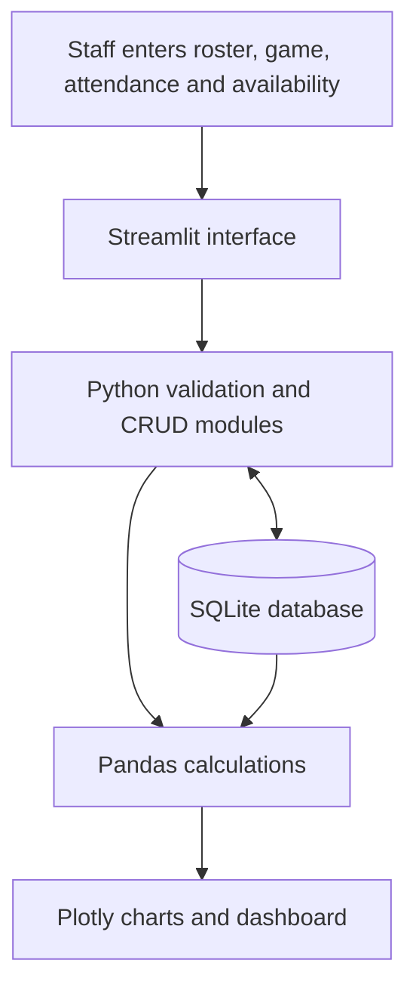

# Gridiron-Tracker[Gridiron_Tracker_README.md](https://github.com/user-attachments/files/34928431/Gridiron_Tracker_README.md)
# Gridiron Tracker
## CIS 3400 — Advanced Programming | Project 2

**Student:** Dyllon Houghton  
**Project option:** Database-Driven Web Application (Option 2)  
**Status:** Proposed; not yet implemented  
**Final presentation:** December 8, 2026

## 1. Project Overview

**Application name:** Gridiron Tracker

### Problem Statement
Gridiron Tracker is a database-driven web application designed to help college football staff manage game-day participation and attendance. Teams need a simple way to record which players attended games, identify players who are unavailable, and compare fan turnout across the season. Keeping these records together makes game-day reporting faster and helps staff review trends without searching multiple spreadsheets. The application will use fictional demonstration records and will not collect detailed medical diagnoses.

### Intended Users
Option 2 — Database-Driven Web Application. Intended users are football coaches, team managers, athletic operations staff, and authorized administrators. Staff will add games and players, mark game attendance and availability, enter fan totals, and review historical records. Sensitive absence reasons will be visible only in the staff-facing version; the demo will use sample data.

### Unique Features
The application combines player game attendance, fan turnout, and player availability in one searchable database-driven dashboard. Unlike a basic attendance list, it separates whether a player attended from whether they were available to play.

## 2. Application Features
• Manage a roster with jersey number, position, and class year.
• Record each player as present, absent, late, or excused for each game.
• Separately record availability as available, questionable, or out, with a broad reason category (injury, illness, suspension, personal, other, or undisclosed).
• Record fan attendance per game, with an optional stadium capacity field.
• Dashboard shows player attendance percentage, number available, fan attendance totals, and game-by-game trends.
• Add, view, edit, and delete player, game, and attendance records. Prevent duplicate player/game attendance entries.

## 3. Technologies Used (planned)
| Technology | Purpose |
|---|---|
| Python | Validation, calculations, and CRUD logic |
| Streamlit | Interactive web interface |
| SQLite / sqlite3 | Local persistent database |
| Pandas | Data summaries |
| Plotly | Charts and season trends |

## 4. Application Architecture



### How the Application Works
1. Staff select a game or create a new one.
2. Staff enter fan attendance and update player attendance and availability.
3. Python validates the entries and stores them in SQLite.
4. Pandas calculates rates and aggregates records.
5. Streamlit displays tables, metrics, and Plotly charts.

## 5. Project Structure (planned)
```text
gridiron-tracker/
├── app.py
├── database.py
├── roster.py
├── games.py
├── attendance.py
├── analytics.py
├── tests/
│   └── test_logic.py
├── docs/
│   ├── architecture.png
│   └── screenshots/
├── requirements.txt
└── README.md
```

## 6. Installation and Running the Application
*Planned commands; application is not yet built.*
```bash
git clone <repository-url>
cd gridiron-tracker
pip install -r requirements.txt
streamlit run app.py
```
The database will be initialized on first launch. No external API keys are planned.

## 7. Testing and Validation (planned)
| Test | Expected result | Actual result |
|---|---|---|
| Valid player and game | Saved and displayed | Not yet tested |
| Negative fan count | Rejected with clear error | Not yet tested |
| Duplicate player/game entry | Prevented or updated safely | Not yet tested |
| Empty roster / zero capacity | No division-by-zero error | Not yet tested |
| Edit record and restart | Changes persist | Not yet tested |

## 8. AI-Assisted Development Disclosure
**AI tools planned:** ChatGPT.

### How AI Will Be Used
ChatGPT will assist with brainstorming, proposal writing, starter code, debugging guidance, and test-case suggestions. Actual development assistance and code changes will be documented as work proceeds.

### Student Contributions
I chose the project idea and feature requirements. I will make design decisions, review and modify code, test database operations, and explain the application during the presentation.

**Student statement (to verify before final submission):** I reviewed, tested, and can explain the code and technologies used in my application, including code developed with AI assistance.

## 9. Challenges and Lessons Learned (anticipated)
- Designing linked player, game, and attendance records without duplicates.
- Keeping the dashboard accurate after records are edited.
- Protecting private availability information; the demo will use fictional data and broad reason categories only.

## 10. Application Screenshots
To be added after the prototype is running: main interface and working attendance/availability feature.

## 11. Project Links
**GitHub Repository:** To be added.  
**Deployed Application:** Optional; local operation is acceptable.  
**Demonstration Video:** Optional.

## 12. Future Improvements
1. Staff accounts with role-based access.
2. CSV import/export and multi-season comparisons.

## Implementation Plan
By November 16 (Deliverable 1): finalize design, database schema, architecture, interface sketch, and GitHub README plan.
By November 23 (Deliverable 2 prototype): create SQLite tables; build roster and game entry forms; record one player’s game attendance and availability; save and reload records; enter a fan count; show a basic summary; commit working code to GitHub.
By December 8 (final): complete CRUD for all records, build season charts and filters, improve validation, test edge cases, add screenshots and README instructions, and prepare a 3–5 minute live demonstration.

## Interface Sketch
```text
GRIDIRON TRACKER | Roster | Games | Attendance | Dashboard
[Players] [Present] [Unavailable] [Fan Attendance]
Game: [Select game]   [Add game]
Player # | Attendance | Availability | Broad reason
[Editable player records and fan attendance form]
[Season trend charts and game history]
```

## Data Rules
Tables: players(player_id, name, jersey_number, position, class_year); games(game_id, date, opponent, home_away, fan_attendance, stadium_capacity); player_game_records(record_id, player_id, game_id, attendance_status, availability_status, reason_category). A unique constraint on (player_id, game_id) prevents duplicate entries. Player attendance rate = present players ÷ roster players with recorded statuses × 100 (late counts as present; excused and absent do not). Fan turnout is an entered count, not automatically measured; optional capacity percentage = fan attendance ÷ stadium capacity × 100. Missing values are displayed as unknown rather than zero.
